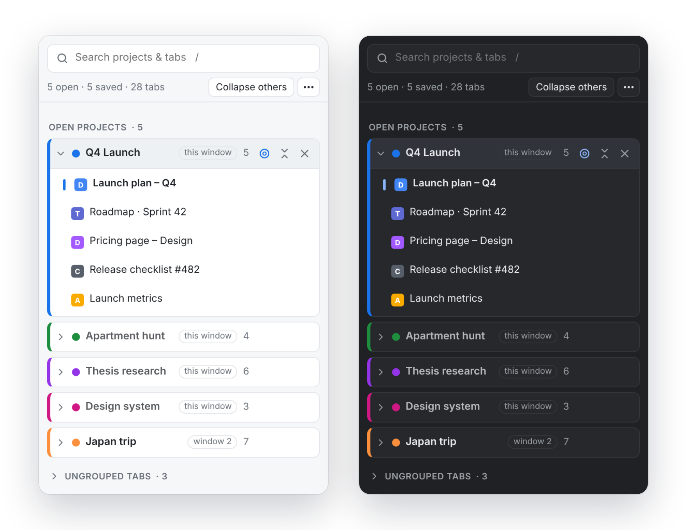
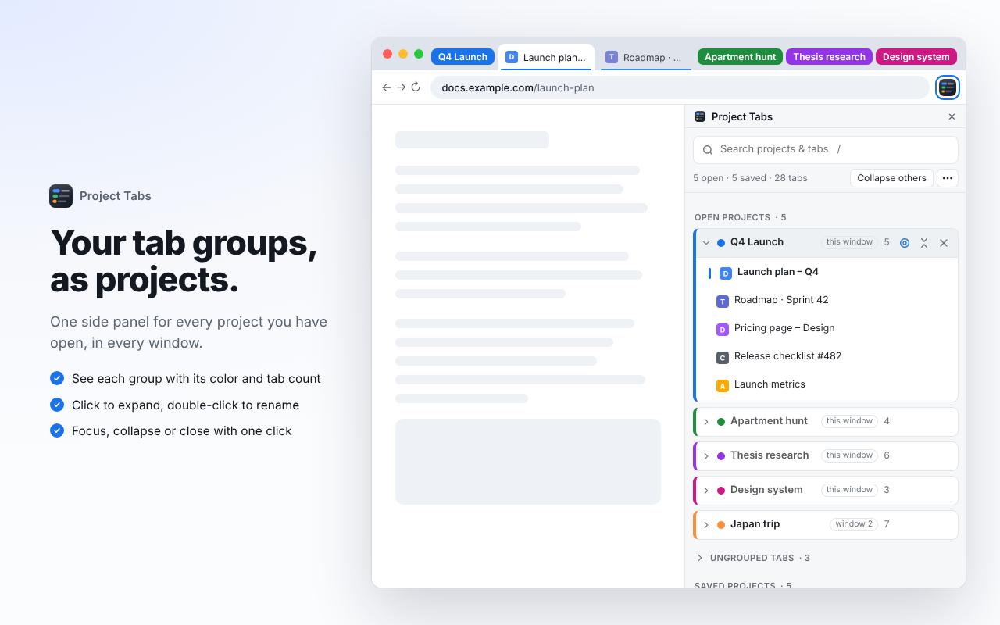
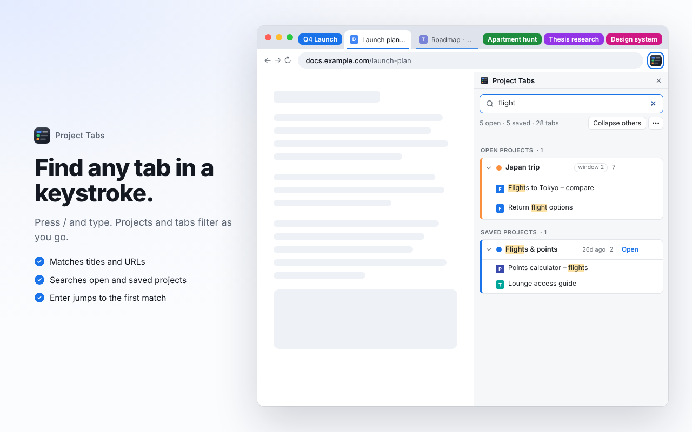
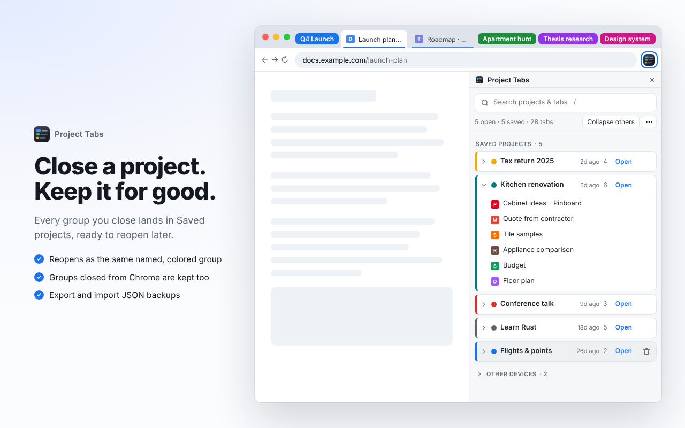
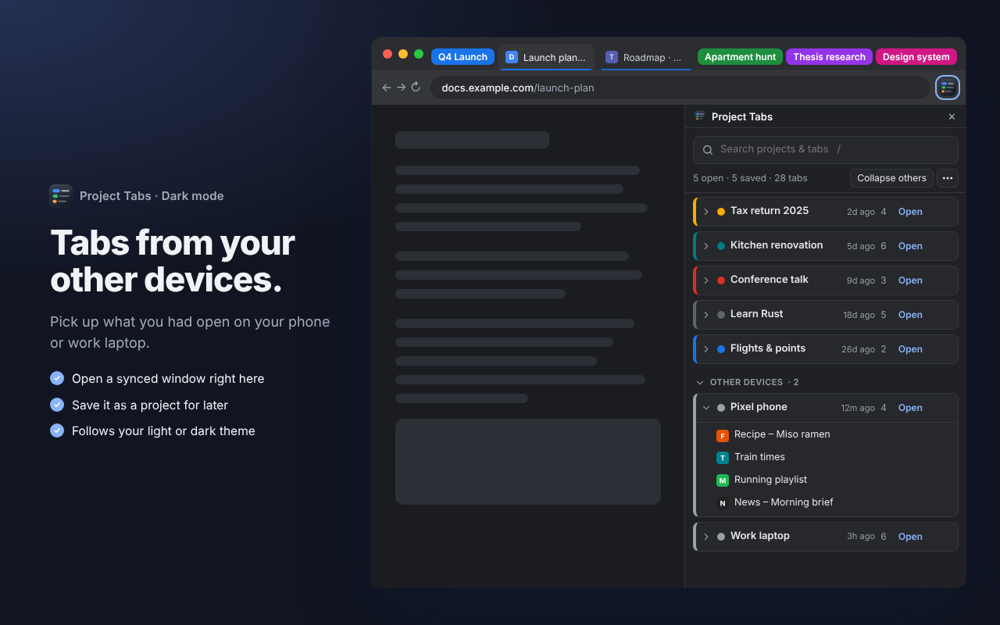
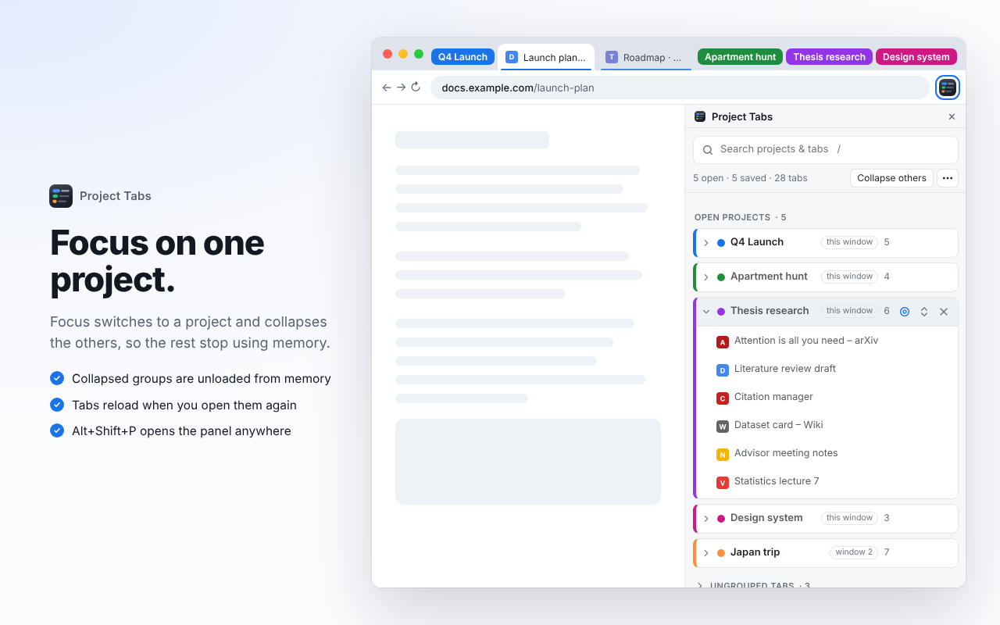

# Project Tabs

**Your Chrome tab groups, as projects.** 
One side panel to see, search, focus, close and reopen every project you work on.

 

---

## Contents

- [Why Project Tabs](#why-project-tabs)
- [Features](#features)
- [Screenshots](#screenshots)
- [Install](#install)
- [Using it](#using-it)
- [Moving in your Chrome saved groups](#moving-in-your-chrome-saved-groups)
- [Privacy and permissions](#privacy-and-permissions)
- [Good to know](#good-to-know)

## Why Project Tabs

Tab groups are a great way to keep a project together, but Chrome only shows them as small chips in the tab strip, and closed groups are easy to lose. Project Tabs gives every group a proper home: a side panel that lists all your projects across all windows, finds any tab in a keystroke, and remembers every project you close so you can bring it back later exactly as it was.

## Features

### 🗂️ Open projects
Every tab group in every window, with its color, name and tab count. Click a project to expand its tabs, click a tab to jump to it, and double-click a project's name to rename it. When you have more than one window open, each project shows which window it's in.

### 🔎 Instant search
Press <kbd>/</kbd> anywhere in the panel and start typing. Open projects, saved projects, ungrouped tabs and tabs from other devices all filter as you type, matching both titles and URLs, with the matches highlighted. <kbd>Enter</kbd> jumps to the first open match and <kbd>Esc</kbd> clears the search.

### 🎯 Focus
The target button on a project switches to it and collapses every other group in that window, so the tab strip shows only what you're working on. **Collapse others** in the toolbar does the same for the project you're already in.

### 💤 Collapsed means unloaded
When a group is collapsed, from the tab strip, Focus or Collapse others, its tabs are unloaded from memory. They stay in the group and reload the moment you open them. The tab you're looking at and tabs playing audio are never unloaded.

### 📚 Saved projects
Project Tabs keeps a permanent library of every group it has seen: its name, color and tabs. Any project that isn't open right now appears under **Saved projects**, newest first.

- **Open** brings it back as the same named, colored group in the current window, or jumps to it if it's already open.
- Groups closed any other way (from Chrome's tab strip, by closing the window, or by quitting Chrome) are kept too, with the tabs they had last.
- The trash button removes a project from Project Tabs for good.

### ✖️ Close a project
The × button on an open project closes its tabs and keeps the project under Saved projects. It's the tidy way to put a project away until you need it again.

### 📱 Other devices
See the windows and tabs open on your other signed-in computers and phone (needs Chrome Sync with *Open tabs* turned on). **Open** brings a window over to this computer, and the box button saves it as a project for later.

### 💾 Backup and restore
**⋯ → Export backup** saves every project to a JSON file. **Import backup** adds the projects from a file to Saved projects. Backups from older versions of Project Tabs import too.

### 🌗 Light and dark
The panel follows your system theme automatically.

### ⌨️ Keyboard shortcut
<kbd>Alt</kbd>+<kbd>Shift</kbd>+<kbd>P</kbd> opens the panel from any tab. Change it at `chrome://extensions/shortcuts`.

## Screenshots

<table>
  <tr>
    <td></td>
    <td></td>
  </tr>
  <tr>
    <td align="center"><b>Every project at a glance</b></td>
    <td align="center"><b>Search titles and URLs</b></td>
  </tr>
  <tr>
    <td></td>
    <td></td>
  </tr>
  <tr>
    <td align="center"><b>Saved projects, ready to reopen</b></td>
    <td align="center"><b>Other devices, in dark mode</b></td>
  </tr>
  <tr>
    <td colspan="2"></td>
  </tr>
  <tr>
    <td colspan="2" align="center"><b>Focus on one project and unload the rest</b></td>
  </tr>
</table>

Screenshots use made-up sample data.

## Install

**From the Chrome Web Store**: coming soon.

**From source**

1. Download or clone this repository and keep the folder somewhere permanent (Chrome loads it from disk).
2. Open `chrome://extensions` and turn on **Developer mode** (top right).
3. Click **Load unpacked** and choose the `project-tabs` folder.
4. Pin Project Tabs to the toolbar, then click its icon or press <kbd>Alt</kbd>+<kbd>Shift</kbd>+<kbd>P</kbd>.

## Using it

| Action | How |
| --- | --- |
| Open the panel | Toolbar icon, or <kbd>Alt</kbd>+<kbd>Shift</kbd>+<kbd>P</kbd> |
| Start a project | Right-click a tab → **Add tab to new group** |
| Search | <kbd>/</kbd>, then type. <kbd>Enter</kbd> jumps, <kbd>Esc</kbd> clears |
| Rename a project | Double-click its name, then <kbd>Enter</kbd> |
| Focus a project | Hover it → target button |
| Collapse or expand in the tab strip | Hover it → arrows button |
| Put a project away | Hover it → × |
| Bring it back | **Saved projects** → **Open** |
| Back up everything | **⋯** → **Export backup (.json)** |

## Moving in your Chrome saved groups

Chrome doesn't let extensions read the groups saved on your bookmarks bar while they're closed. To move them into Project Tabs, click each one on the bookmarks bar once to open it. Project Tabs records it straight away, and you can then close it from the panel with ×. From then on it lives under Saved projects.

Closing from the panel ungroups the tabs before closing them, so Chrome doesn't keep a second saved copy on the bookmarks bar. Groups you close from Chrome's own tab strip keep Chrome's copy as well.

## Privacy and permissions

Project Tabs has no servers, no analytics and no tracking. Your projects are stored in your own browser (`chrome.storage.local`) and never leave it. The full policy is in [PRIVACY.md](PRIVACY.md).

| Permission | Why it's needed |
| --- | --- |
| `tabs` | Read tab titles and URLs to list, search and save the tabs in each project, and to switch to, open and close tabs |
| `tabGroups` | List, rename, collapse and create tab groups |
| `storage` | Keep your saved projects in your browser |
| `sidePanel` | Show the panel |
| `favicon` | Show each tab's site icon from Chrome's own cache |
| `sessions` | Show tabs from your other signed-in devices |

It asks for no access to the content of web pages.

## Good to know

- **Incognito windows** only appear if you turn on *Allow in Incognito* on the extension's details page.
- When you open a saved project, Chrome creates a new group for it. If Chrome also has its own saved copy of that group on the bookmarks bar, you may see both; delete Chrome's copy there.
- Your library lives in this browser profile. Export a backup now and then.

## License

Copyright © 2026 Daniel Huri. All rights reserved. The code is public so you can see how Project Tabs works, but you may not copy, redistribute or publish it. See [LICENSE](LICENSE).
